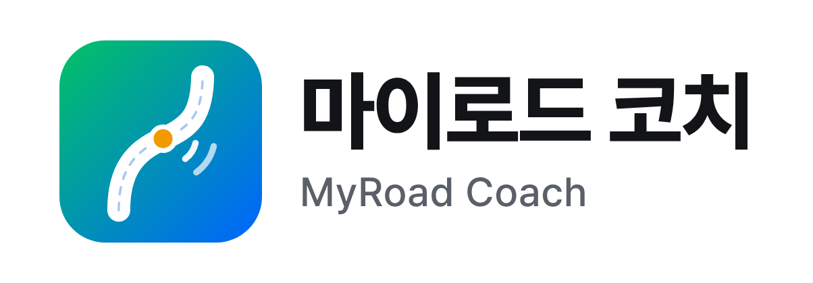

<p align="center">
  
</p>

# 마이로드 코치 (MyRoad Coach)

차량 데이터로 나의 나쁜 운전 습관을 찾아 알려 주고, 그 습관이 자주 나오는 도로 유형에 들어서기 직전에 음성으로 미리 코칭해 주는 Pleos Connect 앱입니다.

## 실행 방법

1. Android Studio로 이 폴더(`MyRoadCoach`)를 엽니다. Gradle 동기화 중 SDK 라이선스 동의 창이 나오면 내용을 확인하고 동의합니다.
2. Pleos Connect 에뮬레이터(AVD)를 실행합니다.
3. 실행 대상으로 에뮬레이터를 선택하고 **Run**을 누릅니다.
4. 앱 상단의 **시나리오 재생** 버튼을 누르면 약 40초 동안 '출근길' 주행이 재생됩니다.
   - 주행 시작 → 합류 구간 500m 전 음성 코칭 → 40m 전 제동(늦은 감속 기록)
   - IC 진출 500m 전 음성 코칭 → 방향지시등 없이 진출(방향지시등 미사용 기록)
   - 어린이보호구역 과속 안내 → 도착 후 정차 → **오늘의 하이라이트** 화면으로 전환
5. 하이라이트에서 `앞에 돌발 상황이 있었어요`를 누르면 해당 기록이 습관 분석에서 빠집니다.
6. 오른쪽 위 마이크 버튼을 누르면 주간 요약을 음성으로 들려줍니다.

release APK 만들기: `./gradlew assembleRelease` → `app/build/outputs/apk/release/app-release.apk`
(공모전 제출 규칙에 따라 `apk/팀명_앱이름_release.apk`로 복사해 올립니다.)

판단 로직 단위 테스트: `./gradlew test`

자동 빌드: PR과 main push마다 GitHub Actions(`.github/workflows/android-build.yml`)가 단위 테스트와 debug/release APK 빌드를 실행합니다. 빌드된 release APK는 Actions 실행 결과의 Artifacts(`myroad-coach-release-apk`)에서 내려받을 수 있습니다.

## 테스트 환경

- Android Studio (최신 버전), Android SDK API 34
- minSdk 28 / compileSdk 34 / targetSdk 34, Gradle 8.11.1, AGP 8.7.3, Kotlin 2.0.21, Jetpack Compose
- Pleos Connect Emulator: 2.1.0 (API 34 system image), 화면 규격 Connect-S-17 (2560×1440, 앱 창 가로 1700×1184 / 세로 840×1184)
  - 실제로 사용한 에뮬레이터 버전과 화면 규격이 다르면 이 항목을 수정하세요.

## 사용한 Pleos Connect SDK

| SDK | 버전 | 사용 API | 용도 |
|---|---|---|---|
| Vehicle | 2.3.2 | Brake `registerBrakePedalStatus`, Gear `registerGearSelection`, SteeringWheel `registerSteeringWheelAngle`, TurnSignal `registerTurnSignalState` | 늦은 감속·방향지시등 미사용 판별, 주행/정차 전환 |
| NaviHelper | 3.0.5 | `onTBTInfo`, `onCautionPointInfo`, `onCameraAlert`, `onDestinationArrived` | 도로 유형 판별, 진입 전 코칭 시점, 과속 안내, 주행 종료 |
| TextToSpeech | 3.3.1 | `TextToSpeech(context, Mode.ON_DEVICE)`, `speak()` | 진입 전 음성 코칭, 주간 요약 음성 |
| FusedLocation | 1.1.3 | (의존성 포함, 자주 위험했던 지점 근접 알림 확장 예정) | |

선언한 권한: `CAR_DRIVE`, `CAR_LIGHTS`, `NAVI_ROUTE`, `FUSED_LOCATION`, `TTS_SERVICE`

## 경로 데이터 출처

- 시연 경로 좌표: [OSRM](https://project-osrm.org) 경로, © [OpenStreetMap contributors](https://www.openstreetmap.org/copyright)

## 로고

`docs/brand/`에 로고 원본(`logo.svg`)과 PNG(1024·512px, 가로형 밝은/어두운 배경)가 있습니다. 앱 아이콘은 `app/src/main/res/drawable/ic_logo.xml`(같은 그림의 벡터)입니다.

## 구조

```
app/src/main/java/com/myroad/coach/
├─ MainActivity.kt           앱 화면 전환 (주행 중에는 코칭 카드만, 정차 중에는 탭 3개)
├─ engine/CoachEngine.kt     판단 로직: 진입 전 코칭, 구간 직전 제동, 방향지시등(방향 일치), 구간 과속, 판정 기회(정상·위험·판정 불가)
├─ engine/ScenarioPlayer.kt  시연용 주행 시나리오 (실제 SDK 이벤트와 같은 경로로 엔진에 입력)
├─ sdk/LiveSources.kt        Vehicle·NaviHelper·FusedLocation SDK 연결 (와이퍼, 재탐색, 카메라 id 포함)
├─ sdk/Speaker.kt            Pleos TTS + 오디오 포커스 (못 받으면 화면 카드만), 실패 시 기본 TTS
├─ sdk/RoadTypeMapper.kt     TurnType / CautionPointType → 도로 유형 + 방향(좌·우)
├─ sdk/NightCalc.kt          위치·시각으로 일몰 여부 계산 (야간 판정)
├─ data/HabitAnalyzer.kt     습관·약점·주간 비교 계산 (분모와 건수 기반, 표본 부족 시 '데이터 부족')
├─ data/Models.kt            데이터 구조와 습관 리포트 예시 데이터
└─ ui/                       Pleos 디자인 가이드 색상·타이포그래피 기반 화면
```

## 현재 한계

- 처음 설치하면 시연용 4주치 샘플 기록(32회)으로 시작하며, 화면에 "시연용 샘플" 배지가 표시됩니다. ··· 메뉴에서 초기화할 수 있습니다.
- 하이라이트는 인터넷 지도 없이, FusedLocation으로 기록한 좌표로 실제 도로 모양의 경로와 위험 지점을 그립니다. 위치 기록이 없으면 기본 곡선 위에 위험 지점을 배치합니다 ("경로 예시").
- 시연 시나리오와 첫 화면 예시는 실제 도로 경로(판교 → 경부고속도로 → 양재IC → 강남, OSRM 경로 좌표)를 따라 재생됩니다 ("시연 경로" 표시).
- 음성 인식(SpeechToText)은 쓰지 않습니다. "이번 주 요약 듣기"는 분석 요약을 화면에 띄우고 음성으로 읽어 주는 기능입니다.
- Vehicle SDK에는 차량 속도 API가 없어, 실제 감속도 기반 '급제동'은 기록하지 않고 '구간 직전 제동'(감속 구간 50m 이내에서야 첫 제동)으로 판단합니다.

## 판정 원칙

| 행동 | 분모 (판정 기회) | 위험 | 판정 불가 (분모에서 제외) |
|---|---|---|---|
| 구간 직전 제동 | 실제로 지나간 합류·분기, IC 진출, 회전교차로, 급회전 | 이 구간 첫 제동이 50m 이내 | 브레이크 신호를 한 번도 못 받음 |
| 방향지시등 미사용 | 실제로 지나간 회전·분기 (조향 30° 이상) | 안내 방향과 같은 쪽이 꺼져 있음 | 방향지시등·조향 신호 없음, 조향 근거 없음 |
| 구간 과속 | 안내를 받은 단속 카메라 (카메라 id당 1회) | 과속 안내 | — |

- 재탐색·경로 취소로 지나가지 않은 구간은 판정하지 않고, 남은 코칭 카드와 음성을 거둡니다.
- 습관: 행동별 판정 10회 이상일 때만 비율을 보여 주고, 그 전에는 "데이터 부족"으로 표시합니다.
- 약점 구간: 행동 × 도로 유형별로 5회 이상 판정, 같은 행동의 내 평균 대비 1.5배 이상 (초기값).
- 성장 리포트: 같은 행동·같은 구간을 지난주와 이번 주 건수로 비교하고(주당 5회 이상), 부족하면 비교를 보류합니다. 빈 주는 0으로 채우지 않습니다.
- 우천은 앞유리 와이퍼가 30초 이상 켜져 있을 때 "우천 추정", 야간은 위치·시각으로 계산한 일몰 후입니다.
- 위치가 5초 이상 갱신되지 않았거나 정확도가 낮으면 위험 순간에 위치를 붙이지 않고 "위치 확인 불가"로 표시합니다.
